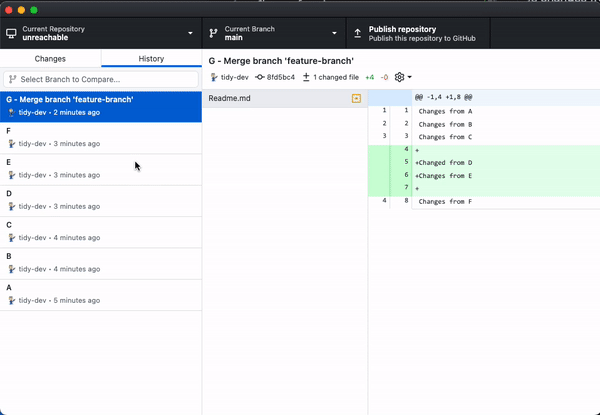
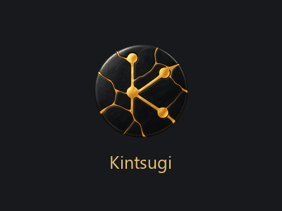

<div align="center">


# Kintsugi

**A refined, personal Git desktop client crafted for Windows**

*Embracing history, branching, and repair — powered by Electron, TypeScript, and React.*

<p>
  <a href="LICENSE"></a>
  
  
  
  
</p>

---

<p>
  <a href="#-about-kintsugi">About</a> •
  <a href="#-key-features">Features</a> •
  <a href="#-visual-tour">Visual Tour</a> •
  <a href="#-installation">Installation</a> •
  <a href="#-building-from-source">Building</a> •
  <a href="#-icon--design-philosophy">Design</a> •
  <a href="#-license--credits">License</a>
</p>

<picture>
  <source
    srcset="https://user-images.githubusercontent.com/634063/202742848-63fa1488-6254-49b5-af7c-96a6b50ea8af.png"
    media="(prefers-color-scheme: dark)"
  />
  
</picture>

</div>

---

## 🍵 About Kintsugi

**Kintsugi** (金継ぎ, *"golden joinery"*) is the traditional Japanese art of mending broken pottery with lacquer dusted in powdered gold, silver, or platinum. Rather than disguising wear and fissures, Kintsugi illuminates them — making the piece stronger and more unique through its history.

In software development and version control, our branches, merges, rebases, and resolved conflicts are our golden seams. 

**Kintsugi** is a standalone, customized Windows x64 build of GitHub Desktop designed for developers seeking a focused, privacy-conscious, and self-contained Git workflow:

- 🪟 **Independent Windows Application**: Uses its own identity, application name, executable (`Kintsugi.exe`), Windows shortcut icons, and isolated application data directory (`%APPDATA%\Kintsugi`).
- 🛡️ **Privacy & Autonomy**: Upstream usage reporting, telemetry pings (`central.github.com`), and automatic background update checks are removed or deactivated.
- 💻 **Offline & Local-First**: Work with any local Git repository immediately—no sign-in or remote account required.
- 🤝 **Seamless Cloud Compatibility**: Supports GitHub authentication whenever you wish to push, pull, or manage pull requests on remote repositories.

---

## ✨ Key Features

<table>
  <tr>
    <td width="50%">
      <h3>🔍 Visual Diffing &amp; Staging</h3>
      <p>Inspect code diffs with syntax highlighting, stage individual hunks or entire files, and craft granular, meaningful commits.</p>
    </td>
    <td width="50%">
      <h3>🌿 Intuitive Branch History</h3>
      <p>Switch, create, rename, and merge branches effortlessly with clear visualization of your project's commit tree.</p>
    </td>
  </tr>
  <tr>
    <td width="50%">
      <h3>🍒 Interactive Cherry-Picking</h3>
      <p>Drag, drop, and cherry-pick specific commits across branches with intuitive conflict resolution helpers.</p>
    </td>
    <td width="50%">
      <h3>⚡ Command-Line Integration</h3>
      <p>Launch directly from PowerShell, Windows Terminal, or CMD using the lightweight <code>kintsugi</code> CLI tool.</p>
    </td>
  </tr>
  <tr>
    <td width="50%">
      <h3>👥 Co-Authorship Made Simple</h3>
      <p>Easily attribute contributions and pair-programming sessions with automatic GitHub co-author suggestions.</p>
    </td>
    <td width="50%">
      <h3>🎨 Custom Japanese Kintsugi Aesthetic</h3>
      <p>Bespoke obsidian disc and gold seam branding, Windows installer splash art, and polished dark/light themes.</p>
    </td>
  </tr>
</table>

---

## 📸 Visual Tour

### 1. Interactive Branch &amp; Commit Management
Easily track branch states, undo changes, and recover unreachable or amended commits through an intuitive timeline.

<p align="center">
  
</p>

### 2. Streamlined Cherry-Picking
Port changes cleanly across branches without touching messy command-line flags.

<p align="center">
  
</p>

### 3. Dedicated Installer Experience
Custom installer branding and splash screen built specifically for Kintsugi on Windows.

<p align="center">
  
</p>

---

## 🚀 Installation &amp; Usage

### Running the Installer

Run the generated Windows installer:

```powershell
dist/KintsugiSetup-x64.exe
```

Upon installation, Kintsugi configures:
- Start Menu and Desktop shortcuts with the custom gold-and-obsidian icon.
- A dedicated user data folder at `%APPDATA%\Kintsugi` (isolated from standard GitHub Desktop installations).
- The `kintsugi` command-line utility in your environment path.

### Command-Line Usage

Open any repository directly from your terminal:

```powershell
# Open current working directory
kintsugi .

# Open a specific repository path
kintsugi C:\Work\my-project
```

---

## 🛠️ Building from Source

### Prerequisites

Ensure the following tools are installed on your Windows machine:
- **Node.js** (v24+; project-local Node in `.tools/node-v24.22.1-win-x64` is used when present)
- **Python** (required for compiling native Node modules)
- **Visual Studio C++ Build Tools** (Desktop development with C++)
- **Git for Windows**

### Build Steps

1. **Clone the repository:**
   ```powershell
   git clone https://github.com/projectGloria/Kintsugi.git
   cd Kintsugi
   ```

2. **Compile and package Kintsugi:**
   Run the automated PowerShell build script:
   ```powershell
   ./script/build-kintsugi.ps1
   ```
   This script handles production compilation, bundle optimization, and installer creation. The resulting package will be output to:
   ```
   dist/KintsugiSetup-x64.exe
   ```

3. **Verify with the Automated Test Suite:**
   Run the end-to-end smoke test to confirm packaging, identity isolation, and telemetry suppression:
   ```powershell
   node script/test-kintsugi.mjs
   ```

---

## 🎨 Icon &amp; Design Philosophy

<p align="center">
  
</p>

> *"A dark charcoal ceramic circular disc repaired with bold elegant gold seams, the seams subtly suggesting a branching Git graph and the letter K."*

The icon embodies the spirit of Kintsugi:
- **Obsidian Ceramic**: Represents the solid foundation of your codebase.
- **Warm Gold Veins**: Symbolize branches, merges, and iterative improvements that make code resilient and enduring.
- **Distraction-Free**: Clean silhouette engineered for high contrast and legibility across all Windows taskbar, system tray, and desktop resolutions (16px to 256px).

---

## 📜 Upstream &amp; License

Kintsugi is built on top of [GitHub Desktop](https://desktop.github.com), distributed under the **[MIT License](LICENSE)**.

- **Attribution**: Original code and architecture &copy; GitHub, Inc. and its community contributors.
- **Trademarks**: GitHub&reg; and the Octocat logo are trademarks of GitHub, Inc. Kintsugi uses its own original icon and branding and is not sponsored or endorsed by GitHub, Inc.
- **License**: See the full [LICENSE](LICENSE) file for terms and conditions.
